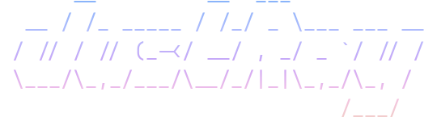
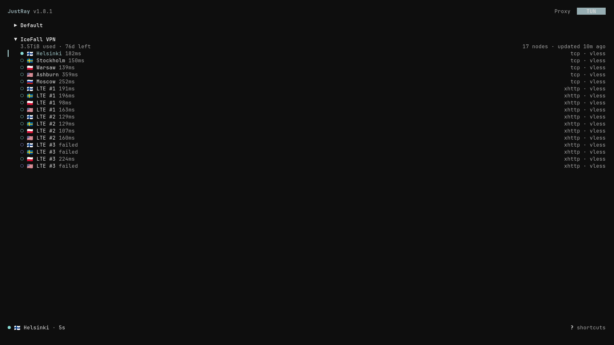
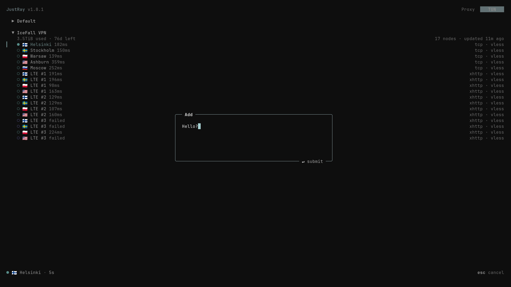
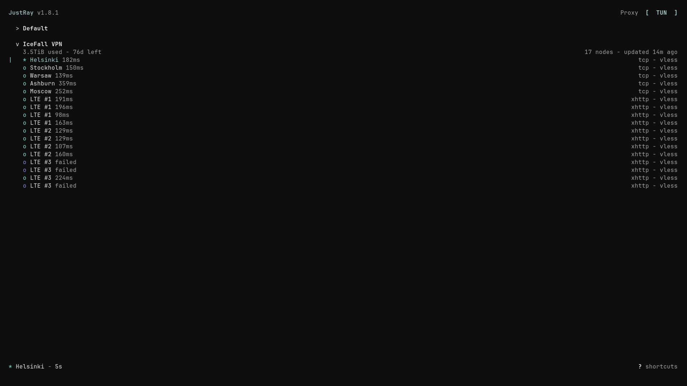
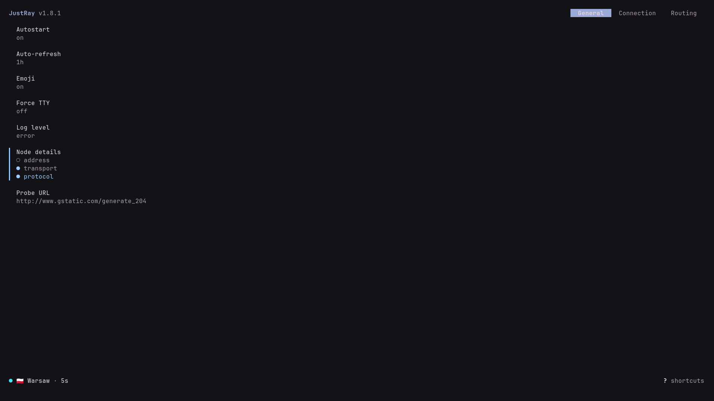

<p align="center">
  
</p>

<p align="center">
  <a href="https://github.com/luynrs/justray/commits/main"></a>
  
  <a href="https://github.com/luynrs/justray/releases"></a>
</p>

<p align="center">
  Современный VPN-клиент, обитающий в вашем терминале
</p>

<p align="center">
  <a href="../../README.md">English</a> / <a href="README.RU.md">Русский</a> / <a href="README.CN.md">简体中文</a>
</p>

<p align="center">
  .<">
</p>

### Возможности

- **Протоколы:** VMess, VLESS, Trojan, WireGuard/AmneziaWG, Shadowsocks, Hysteria 1/2, TUIC, AnyTLS, SOCKS5 и другие
- **Гибкий:** импорт подписок из ссылок, Clash/Mihomo YAML, sing-box или Xray JSON с автоматическим обновлением и широким выбором настроек
- **Автономный:** демон и встроенное ядро sing-box работают независимо от TUI, сохраняя подключение после закрытия интерфейса
- **Легковесный:** около 50 МБ RAM на Linux / MacOS и 100 МБ на Windows
- **Маршрутизация:** правила для приложений, доменов, wildcard-шаблонов и GeoIP/Geosite
- **Кроссплатформенный:** работает в современных терминалах на Linux, MacOS 13+ и Windows 1803+

### Установка

Через пакетный менеджер:

```bash
# Linux / MacOS
brew install luynrs/tap/justray
```

```bash
# Arch Linux
yay -S justray-bin
```

```powershell
# Windows
winget install luynrs.justray
```

С использованием [x-cmd](https://www.x-cmd.com/mod/eget):

```bash
x eget use luynrs/justray
```

Или через скрипт:

```bash
# Linux / MacOS
curl -fsSL https://raw.githubusercontent.com/luynrs/justray/main/install.sh | sh
```

```powershell
# Windows
irm https://raw.githubusercontent.com/luynrs/justray/main/install.ps1 | iex
```

Nix:

```bash
nix run github:luynrs/justray
```

```nix
# Home Manager
{
  imports = [ justray.homeManagerModules.default ];
  services.justray.enable = true;
}
```

### Использование

При установке через пакетный менеджер (кроме WinGet) или скрипт также доступен `jray` как короткий алиас для `justray`

- `justray`: открыть TUI

#### Подключение

- `justray up <node> [--tun | --proxy]`: запустить и подключиться
- `justray down`: отключиться
- `justray stop`: остановить демон
- `justray probe [sub | id | name]`: измерить пинг
- `justray status [--json]`: показать состояние подключения
- `justray logs [daemon | engine] [-f]`: просмотреть логи

#### Подписки и узлы

`justray subscription <command>` или `justray sub <command>`

- `add <url>`: добавить подписку или ссылку на узел
- `remove <id | name>`: удалить подписку по ID или имени
- `refresh [id | name]`: обновить подписки
- `list [--json]`: вывести список подписок и узлов

#### Дополнительно

- `-h`, `--help`: показать справку
- `-v`, `--version`: показать текущую версию

### Горячие клавиши

| **Кнопка** | **Действие** | **Кнопка** | **Действие** |
| ------------ | ------------ | ------------ | ------------ |
| `↑/↓`, `k/j`   | Навигация                  | `Shift+↑/↓`   | Изменить порядок подписок |
| `←/→`, `h/l`   | Свернуть / развернуть      | `Enter`       | Подключиться / отключиться |
| `Home` / `End` | В начало / конец списка    | `/`           | Фильтровать узлы       |
| `t` / `T`      | Проверить задержку выбранного / всех узлов | `r` / `R` | Обновить выбранную / все подписки |
| `m`            | Переключить режим (PROXY / TUN) | `?`      | Показать справку       |
| `a`            | Добавить подписку / узел   | `d`           | Удалить подписку       |
| `o`            | Открыть настройки          | `Tab`         | Переключить вкладку настроек |
| `Esc`          | Сохранить настройки / отменить ввод | `q`, `Ctrl+C` | Выйти из TUI   |

### Скриншоты

| Основной интерфейс | Окно добавления |
|:---:|:---:|
|  |  |
| **Интерфейс в TTY-режиме** | **Настройки** |
|  |  |

### Лицензия

[GPL-3.0-or-later](../../LICENSE)
