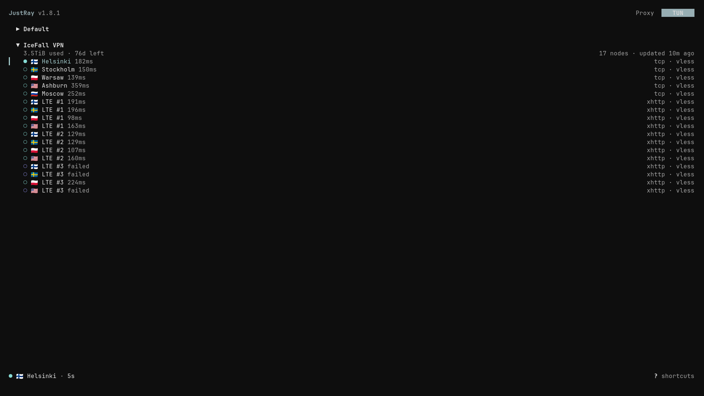
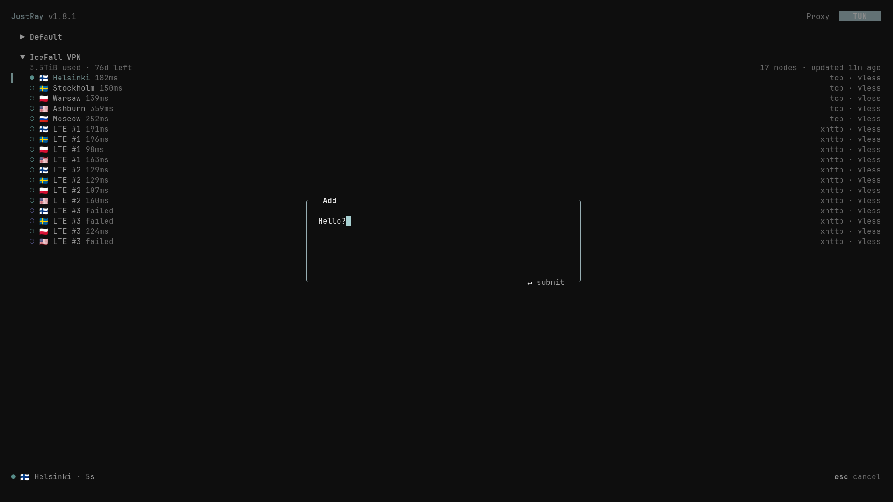
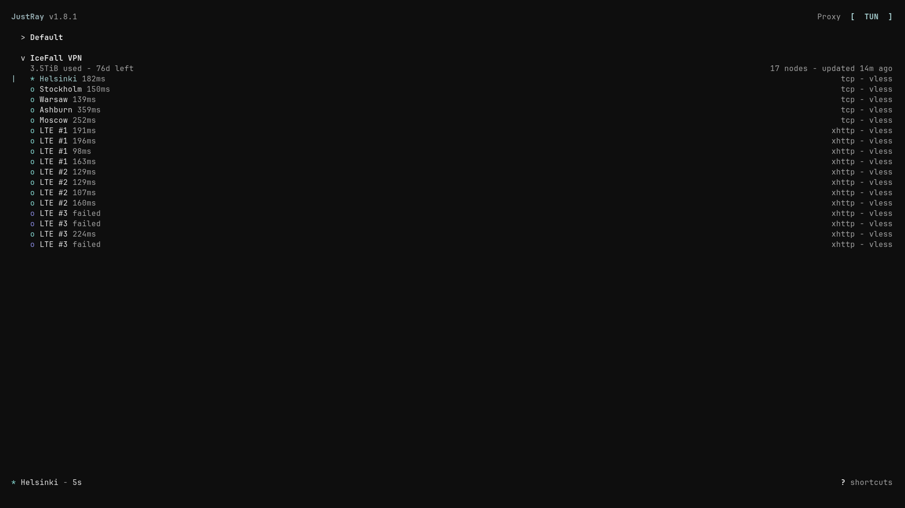
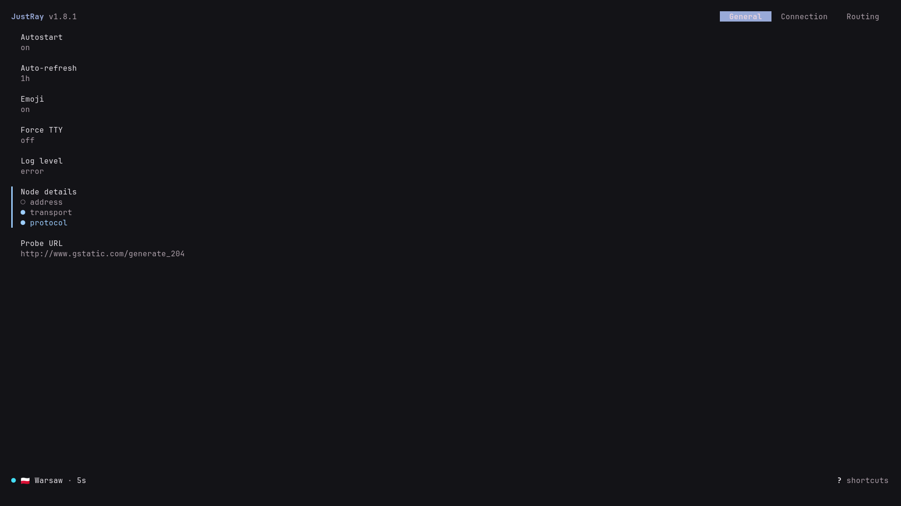

<p align="center">
  
</p>

<p align="center">
  <a href="https://github.com/luynrs/justray/commits/main"></a>
  
  <a href="https://github.com/luynrs/justray/releases"></a>
</p>

<p align="center">
  A modern VPN client that lives in your terminal
</p>

<p align="center">
  <a href="README.md">English</a> / <a href=".github/docs/README.RU.md">Русский</a> / <a href=".github/docs/README.CN.md">简体中文</a>
</p>

<p align="center">
  .<">
</p>

### Features

- **Modern protocols:** VMess, VLESS, Trojan, WireGuard/AmneziaWG, Shadowsocks, Hysteria 1/2, TUIC, AnyTLS, SOCKS5 and other
- **Flexible:** import subscriptions from raw links or Clash/Mihomo YAML, sing-box or Xray json with automatic refresh and a wide range of settings
- **Headless:** the daemon and embedded sing-box core run independently from the TUI, keeping connections alive after you detach
- **Lightweight:** ~50 MB RAM on Linux / MacOS and ~100 MB on Windows
- **Cross-platform:** runs in modern terminals on Linux, MacOS 13+, and Windows 1803+

### Installation

Using package manager:

```bash
# Linux / MacOS
brew install luynrs/tap/justray
```

```bash
# Arch Linux (AUR)
yay -S justray-bin
```

```powershell
# Windows
winget install luynrs.justray
```

Alternatively, with [x-cmd](https://www.x-cmd.com/mod/eget):

```bash
x eget use luynrs/justray
```

Or via script:

```bash
# Linux / MacOS
curl -fsSL https://raw.githubusercontent.com/luynrs/justray/main/install.sh | sh
```

```powershell
# Windows
irm https://raw.githubusercontent.com/luynrs/justray/main/install.ps1 | iex
```

And my dear! Nix:

```bash
nix run github:luynrs/justray
```

```nix
# Home Manager
{
  imports = [ justray.homeManagerModules.default ];
  services.justray.enable = true;
}
```

### Usage

Package manager (except WinGet) and script installations also provide `jray` as a short alias for `justray`

- `justray`: open the TUI

#### Connection 

- `justray up <node> [--tun | --proxy]`: start the daemon and connect
- `justray down`: disconnect
- `justray stop`: stop the daemon
- `justray probe [sub | id | name]`: probe node latencies
- `justray status [--json]`: show connection status
- `jray logs [daemon | engine] [-f]`: view logs

#### Subscriptions & Nodes

`justray subscription <command>` or `justray sub <command>`

- `add`: add a subscription or raw protocol link
- `remove`: remove a subscription by ID or name
- `refresh`: refresh subscriptions
- `list [--json]`: list subscriptions and nodes

#### Additional

- `-h`, `--help`: show help
- `-v`, `--version`: show the current version

### Keybinds

| **Key**      | **Action**              | **Key**       | **Action**             |
| ------------ | ----------------------- | ------------- | ----------------------- |
| `↑/↓`, `k/j` | Navigate                | `Shift+↑/↓`   | Reorder subscriptions  |
| `←/→`, `h/l` | Fold / expand           | `Enter`       | Toggle / connect       |
| `t` / `T`    | Ping selected / all     | `r` / `R`     | Refresh selected / all |
| `m`          | Switch mode (PROXY / TUN) | `/`         | Filter nodes            |
| `a`          | Add subscription / node | `d`           | Delete subscription     |
| `o`          | Open settings           | `Esc`         | Save settings / cancel edit |
| `Tab`        | Switch settings tabs    | `q`, `Ctrl+C` | Exit TUI                |

### Screenshots

| Main UI | Wow... with add modal |
|:---:|:---:|
|  |  |
| **Main UI in TTY mode** | **Settings** |
|  |  |

### License
[GPL-3.0-or-later](LICENSE)
